<div align="center">

<!-- O banner é gerado por scripts/atualizar-readme.mjs com os números do progresso.json (régua, testes, MVP). -->
<a href="https://www.linkedin.com/in/kevin-richard-b68a54203/" target="_blank"></a>

[](https://git.io/typing-svg)

<a href="https://www.linkedin.com/in/kevin-richard-b68a54203/" target="_blank"></a>
<a href="mailto:kevinrichardve@gmail.com"></a>
<a href="https://www.linkedin.com/company/zupinnovation/posts/?feedView=all" target="_blank"></a>
<a href="https://www.itau.com.br/" target="_blank"></a>
<a href="https://www.linkedin.com/school/anhanguera-educacional-sa/" target="_blank"></a>


&nbsp;


<a href="https://github.com/k3vinrich4rd/rkf_bank/actions/workflows/backend-ci.yml"></a>
<a href="https://github.com/k3vinrich4rd/rkf_bank/commits/develop"></a>
<a href="https://github.com/k3vinrich4rd/rkf_bank/pulse"></a>
<a href="https://github.com/k3vinrich4rd/rkf_bank/pulls?q=is%3Apr+is%3Amerged"></a>

<!-- AUTO:status:START -->


<!-- AUTO:status:END -->

<!-- Botões gerados por scripts/svgs.mjs. Cada um leva a uma seção. -->
<a href="#-escolha-a-sua-trilha"></a>
<a href="#-ao-vivo"></a>
<a href="#-trajetória"></a>
<a href="#-projeto-atual--rkf-bank"></a>
<a href="#️-projetos-em-destaque"></a>
<br/>
<a href="#-junior--pleno--onde-estou"></a>
<a href="#-pdi--roadmap-2026"></a>
<a href="#️-tecnologias"></a>
<a href="#-pergunte-ao-kevin"></a>
<a href="#-formação-e-certificações"></a>

<br/><br/>

<!-- Números gerados a partir do progresso.json: rolam a cada visita. -->


</div>


## 🎮 Escolha a sua trilha

> Clique na trilha que mais combina com você. Cada uma abre um caminho diferente pelo meu perfil.
> 👇 Os botões abrem e fecham.

<details>
<summary></summary>
<br/>

<!-- AUTO:recrutador:START -->
| Pergunta | Resposta rápida |
|---|---|
| Quem é? | Dev **Java backend Junior** na **Zup Innovation**, prestando serviço para o **Itaú**, em transição para **Pleno** (**9/15** competências já praticadas) |
| Melhor projeto? | **[RKF Bank](https://github.com/k3vinrich4rd/rkf_bank)**: banco digital com Spring Boot 4, Java 25, MySQL, **109 testes**, CI e logs rastreáveis |
| Stack principal? | Java · Spring Boot · JPA/Hibernate · MySQL/PostgreSQL · MongoDB · JUnit/Mockito · Docker · GitHub Actions |
| O que está estudando? | Flyway → JWT → Testcontainers → AWS → inglês → mensageria |
| Contato? | [LinkedIn](https://www.linkedin.com/in/kevin-richard-b68a54203/) · [kevinrichardve@gmail.com](mailto:kevinrichardve@gmail.com) |
<!-- AUTO:recrutador:END -->

<p align="center">
  <a href="https://www.linkedin.com/in/kevin-richard-b68a54203/" target="_blank"></a>
  <a href="mailto:kevinrichardve@gmail.com?subject=Oportunidade%20-%20Java%20Backend"></a>
</p>

<details>
<summary>👉 Quero ver evidências</summary>
<br/>

- Régua de competências com evidência por projeto: [📈 Junior → Pleno](#-junior--pleno--onde-estou)
- Regras de negócio e qualidade do RKF Bank: [🏦 Projeto atual](#-projeto-atual--rkf-bank)
- Perguntas técnicas respondidas: [💬 Pergunte ao Kevin](#-pergunte-ao-kevin)

</details>

</details>

<details>
<summary></summary>
<br/>

Sugestão de leitura, do mais simples ao mais completo:

1. 🪪 **[cpf-utils](https://github.com/k3vinrich4rd/cpf-utils)**: algoritmo do CPF em Java puro.
2. 👥 **[CRUD de Clientes](https://github.com/k3vinrich4rd/desafio-devsuperior-crud-clientes)**: API em camadas com validação e paginação.
3. 🌐 **[Workshop JPA](https://github.com/k3vinrich4rd/workshop-springboot4-jpa)**: todos os relacionamentos JPA e chave composta.
4. 📚 **[BookMarket](https://github.com/k3vinrich4rd/BookMarket)**: Kotlin, Spring Security e eventos de domínio.
5. 🏦 **[RKF Bank](https://github.com/k3vinrich4rd/rkf_bank)**: transações, lock otimista, logs com `X-Request-Id`, testes `@DataJpaTest` e CI com CodeQL.

<details>
<summary>👉 Onde olhar primeiro no RKF Bank</summary>
<br/>

| Arquivo | Por que é interessante |
|---|---|
| `services/ContaService.java` | transferência atômica e validação de saldo |
| `entities/Conta.java` | `@Version` para lock otimista |
| `controllers/handlers/ControllerExceptionHandler.java` | cada exceção vira o status certo |
| `config/FiltroLogRequisicao.java` | `X-Request-Id` em todos os logs, com proteção contra log forjado |
| `repositories/*Test.java` | testes de JPA de verdade: cascata, `orphanRemoval`, constraints |

</details>

</details>

<details>
<summary></summary>
<br/>

Eu comecei pelo **Programa Catalisa** da Zup em 2022, com exercícios de lógica. O caminho que funcionou para mim:

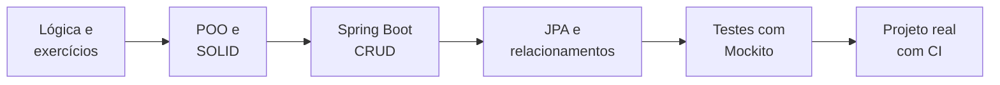

Dica: **um projeto completo vale mais que vinte exercícios soltos**. Em 2022 criei 53 repositórios; em 2026, 4. E os de 2026 contam muito mais sobre mim.

</details>


## 📡 Ao vivo

> Esta seção se atualiza sozinha. Cada commit que eu faço alimenta o meu Obsidian, que alimenta este README. 🤖

<!-- AUTO:dica:START -->
> 💡 **Dica do dia: `Optional.orElseThrow`**  
> Transforma "não achei" em exceção de negócio numa linha, sem if de null espalhado pelo código.  
> <sub>Muda todo dia sozinha · 9/20</sub>
<!-- AUTO:dica:END -->

<!-- A cobrinha é gerada pelo workflow .github/workflows/snake.yml deste repositório (branch "output"). -->
<picture>
  <source media="(prefers-color-scheme: dark)" srcset="https://raw.githubusercontent.com/k3vinrich4rd/k3vinrich4rd/output/snake-dark.svg" />
  <source media="(prefers-color-scheme: light)" srcset="https://raw.githubusercontent.com/k3vinrich4rd/k3vinrich4rd/output/snake.svg" />
  
</picture>

<details open>
<summary><b>⚡ Meus últimos commits</b></summary>
<br/>

<!-- AUTO:atividade:START -->
| Repositório | Último commit | Quando |
|---|---|---|
| [`rkf_bank`](https://github.com/k3vinrich4rd/rkf_bank) | [`1639f18`](https://github.com/k3vinrich4rd/rkf_bank/commit/1639f18f2e04fa83ec5576efc0c42eb38b029627) Merge pull request #22 from k3vinrich4rd/chore/automacao-ia | 15/10/2026 |
| [`JAVA-SPRING-PROFESSIONAL-MODELO-DE-DOMINIO-ORM`](https://github.com/k3vinrich4rd/JAVA-SPRING-PROFESSIONAL-MODELO-DE-DOMINIO-ORM) | [`0849493`](https://github.com/k3vinrich4rd/JAVA-SPRING-PROFESSIONAL-MODELO-DE-DOMINIO-ORM/commit/0849493f006f8569a3c9a93e9578c3ba795d6921) docs: adiciona README com modelo de dominio, endpoints e exemplos reais | 15/10/2026 |
| [`JAVA-SPRING-PROFESSIONAL-MODELO-DE-DOMINIO-ORM`](https://github.com/k3vinrich4rd/JAVA-SPRING-PROFESSIONAL-MODELO-DE-DOMINIO-ORM) | [`cf381a2`](https://github.com/k3vinrich4rd/JAVA-SPRING-PROFESSIONAL-MODELO-DE-DOMINIO-ORM/commit/cf381a2b0fdf09b7ce7b3c3784be9cc876f6352e) fix: salva application-test.properties em UTF-8 | 15/10/2026 |
| [`rkf_bank`](https://github.com/k3vinrich4rd/rkf_bank) | [`2b9ead4`](https://github.com/k3vinrich4rd/rkf_bank/commit/2b9ead4b214adcbba64194463c7419b6ac20d71b) chore(claude): adiciona skills explicar-codigo, revisar-migracao, nova-tela, rec | 15/10/2026 |
| [`desafio-devsuperior-crud-clientes`](https://github.com/k3vinrich4rd/desafio-devsuperior-crud-clientes) | [`9b0eb79`](https://github.com/k3vinrich4rd/desafio-devsuperior-crud-clientes/commit/9b0eb794bf407bdbe22af1196065717ef72591a9) feat: implementando correcao sugerida no feedback | 05/10/2026 |
| [`desafio-devsuperior-crud-clientes`](https://github.com/k3vinrich4rd/desafio-devsuperior-crud-clientes) | [`081441f`](https://github.com/k3vinrich4rd/desafio-devsuperior-crud-clientes/commit/081441fdfcf7970ac1da4a4c57bc751327618575) feat: implementando atualizacoes de readme | 01/10/2026 |
| [`workshop-springboot4-mongodb`](https://github.com/k3vinrich4rd/workshop-springboot4-mongodb) | [`ecad5ce`](https://github.com/k3vinrich4rd/workshop-springboot4-mongodb/commit/ecad5cec16d1f5ef7b606e6f8b5daf5ce74ade25) feat: Implementando ajustes no projeto | 15/09/2026 |
| [`workshop-springboot4-mongodb`](https://github.com/k3vinrich4rd/workshop-springboot4-mongodb) | [`264463c`](https://github.com/k3vinrich4rd/workshop-springboot4-mongodb/commit/264463cd568db8f49e9a3b154dc305bfb5adc906) feat: Implementando ajustes de comentarios no projeto e README.md | 06/09/2026 |

<sub>🤖 Atualizado sozinho pelo GitHub Actions a cada 6 horas.</sub>
<!-- AUTO:atividade:END -->

</details>

<details>
<summary><b>📓 Diário de bordo: o que cada entrega me ensinou</b></summary>
<br/>

<!-- AUTO:diario:START -->
| Quando | Onde | O que eu aprendi |
|---|---|---|
| 2026-10-15 | `fix/vulnerabilidades-dependencias` | dá para corrigir CVE de dependência transitiva sobrescrevendo a propriedade do BOM |
| 2026-10-15 | `feature/testes-repository` | testar mapeamento JPA de verdade (cascata, `orphanRemoval`, `@Version`) |
<!-- AUTO:diario:END -->

</details>

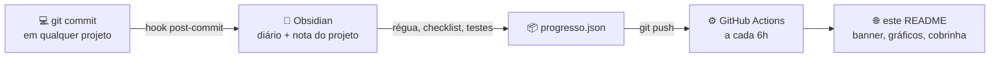


## 🧭 Trajetória

<!-- História em cenas gerada por scripts/svgs.mjs com os números do progresso.json. -->


> 24 anos. Osasco, SP. Dev Junior. Sempre estudando. Sempre evoluindo.

Tenho 24 anos, sou homem negro, pessoa com deficiência física e moro em Osasco, SP.

Entrei na tecnologia pelo **[Programa Catalisa](https://www.linkedin.com/company/zupinnovation/posts/?feedView=all)** da **Zup Innovation**. Hoje sou **Desenvolvedor de Software Junior na Zup**, empresa do grupo **[Itaú](https://www.itau.com.br/)**, e presto serviço para o maior banco privado do Brasil. Estudo todos os dias para chegar ao nível **Pleno**.

> *Conhecimento não tem teto. Código não tem limite. Só tem próximo nível.*

<br clear="right"/>

<details>
<summary><b>📍 De onde eu codo (mapa interativo — arraste e dê zoom)</b></summary>
<br/>

```geojson
{
  "type": "FeatureCollection",
  "features": [
    {
      "type": "Feature",
      "properties": {
        "title": "Osasco, SP",
        "description": "Kevin Richard — Java Backend Developer",
        "marker-color": "#EC7000",
        "marker-size": "large",
        "marker-symbol": "rocket"
      },
      "geometry": { "type": "Point", "coordinates": [-46.7917, -23.5329] }
    }
  ]
}
```

</details>

<details>
<summary><b>📅 Ver minha linha do tempo no GitHub (2022 → 2026)</b></summary>
<br/>

Cada fase abaixo tem repositórios públicos como evidência.

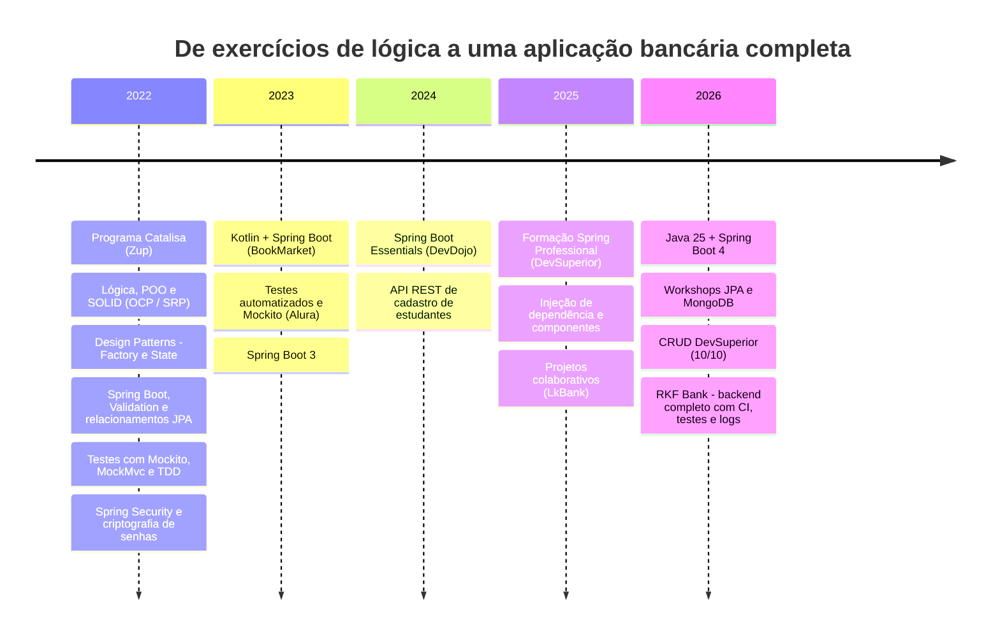

</details>


## 🚀 Sobre mim


<details>
<summary><b>📄 Ver como texto (para copiar)</b></summary>
<br/>

```java
public class Kevin extends Developer implements AprendizContinuo {

    String nome     = "Kevin Richard";
    String cidade   = "Osasco, SP";
    String empresa  = "Zup Innovation (grupo Itaú)";
    String nivel    = "Junior -> Pleno (em progresso)";
    String entrada  = "Programa Catalisa - Zup Innovation";

    List<String> foco       = List.of("Java", "Spring Boot", "APIs REST", "JPA/Hibernate", "Testes", "MongoDB");
    List<String> aprendendo = List.of("AWS", "AI Agents", "Spec-Driven Development", "Skill em IA");
    String ingles           = "Básico (em desenvolvimento ativo)";

    @Override
    public String proximoPasso() {
        return "Dominar o ecossistema Spring, evoluir para Pleno e ampliar meu impacto técnico.";
    }

    public String mentalidade() {
        return "Informação e conhecimento nunca são demais.";
    }
}
```

</details>


## 🏦 Projeto atual — RKF Bank

<div align="center">

<a href="https://github.com/k3vinrich4rd/rkf_bank" target="_blank">
  
</a>


</div>

> Banco digital **full stack** feito em dupla. Eu cuido do **backend**: API REST em Java e Spring Boot, banco MySQL, integração com o ViaCEP, logs e testes. O **[Renan Barros](https://github.com/renanbarrostech-cmd)** cuida do frontend em Next.js. É o projeto em que eu pratico, de ponta a ponta, o que se espera de um dev **Pleno**.

<div align="center">
  
</div>

<div align="center">
  
</div>

<details>
<summary><b>🗃️ Modelo de dados (diagrama interativo)</b></summary>
<br/>

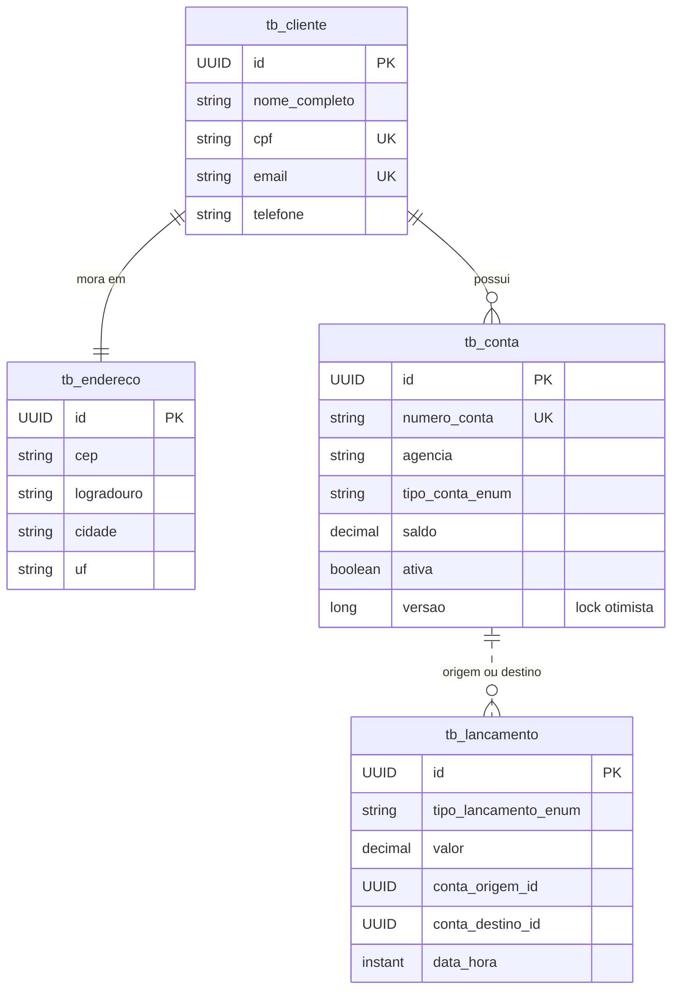

</details>

<details>
<summary><b>🧭 Jornada do cliente no RKF Bank</b></summary>
<br/>

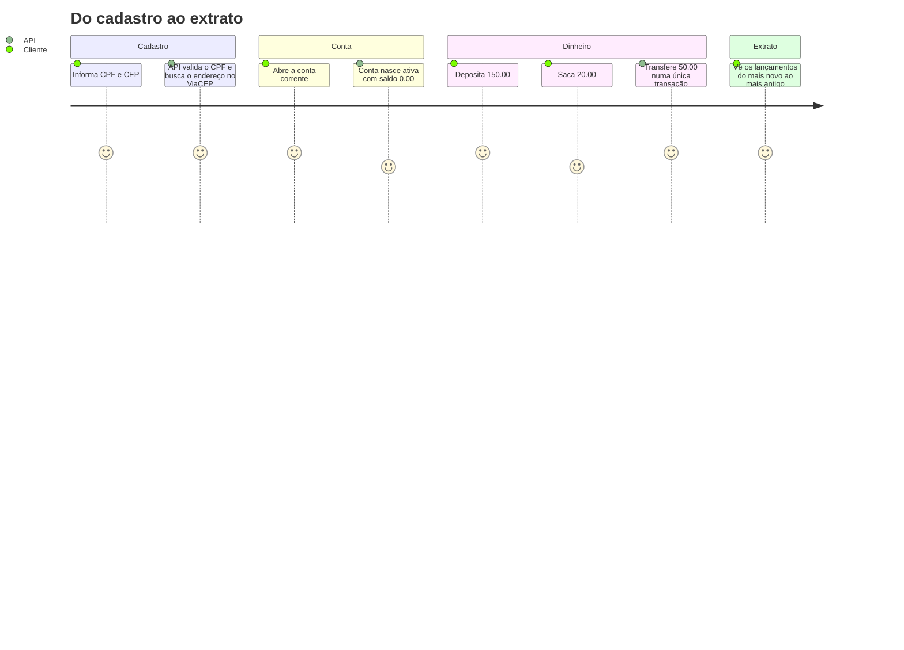

</details>

<details>
<summary><b>💰 Regras de negócio que eu implementei</b></summary>
<br/>

| Fluxo | O que a API garante |
|---|---|
| Cadastro de cliente | CPF validado pelos dígitos verificadores, CPF e e-mail únicos, endereço completo pelo ViaCEP |
| Abertura de conta | conta sempre ligada a um cliente existente, número de conta único |
| Depósito / saque | valor positivo, conta ativa, saque bloqueado sem saldo suficiente |
| Transferência | origem ≠ destino, débito e crédito na **mesma transação** |
| Extrato | lançamentos de entrada e saída, do mais novo para o mais antigo |
| Concorrência | **lock otimista** (`@Version`): duas operações simultâneas na mesma conta resultam em `409`, sem saldo errado |
| Erros | formato único de erro com status certo: `400`, `404`, `409`, `422` e `503` |

</details>

<details>
<summary><b>🧪 Qualidade: testes, CI e segurança</b></summary>
<br/>

| Prática | Como está no projeto |
|---|---|
| Testes em todas as camadas | services e controllers com Mockito, handler de erros, validador de CPF, cliente ViaCEP, filtro de logs |
| Testes de repositório | `@DataJpaTest` com H2: consultas do Spring Data, constraints, cascata, lock otimista e extrato |
| Cobertura | relatório do JaCoCo gerado em todo build |
| Roteiro E2E | roteiro manual com o response de cada request e checklist de validação do MVP |
| Esteira | GitHub Actions compila e testa cada PR; CodeQL, Dependency Review e Dependabot |
| Dependências | CVEs do Tomcat e do Jackson corrigidas sem esperar nova versão do Spring Boot |

</details>

<details>
<summary><b>🔎 Observabilidade e organização do time</b></summary>
<br/>

- **Logs com Log4j2** em todas as camadas, cada linha marcada com o `X-Request-Id` da chamada (e com proteção contra linhas de log forjadas).
- **Git Flow** com `develop`, branches `feature/*` e `fix/*`, Pull Requests revisados e **commits semânticos** (`feat:`, `fix:`, `test:`, `docs:`, `build:`, `ci:`).
- **Documentação viva**: contrato da API, decisões de arquitetura, débitos técnicos e guia de contribuição.

Como uma feature chega na `main`:

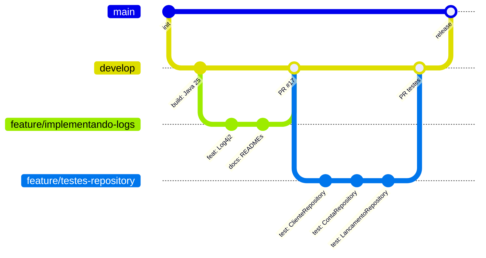

</details>

<details>
<summary><b>🔁 O que acontece quando eu abro um PR</b></summary>
<br/>

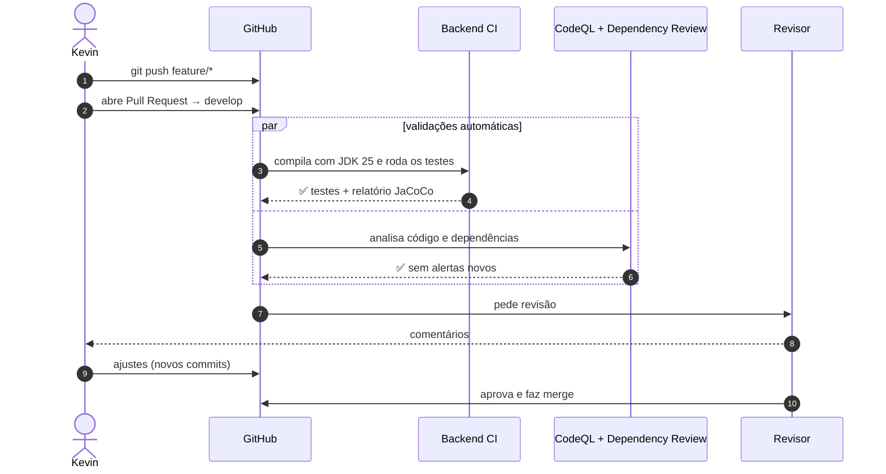

</details>


## 🗂️ Projetos em destaque

### ⭐ Os dois que eu mostraria numa entrevista

<div align="center">

<a href="https://github.com/k3vinrich4rd/rkf_bank" target="_blank"></a>
<a href="https://github.com/k3vinrich4rd/JAVA-SPRING-PROFESSIONAL-MODELO-DE-DOMINIO-ORM" target="_blank"></a>

</div>

| | 🏦 [RKF Bank](https://github.com/k3vinrich4rd/rkf_bank) | 🛒 [DSCommerce](https://github.com/k3vinrich4rd/JAVA-SPRING-PROFESSIONAL-MODELO-DE-DOMINIO-ORM) |
|---|---|---|
| **O que é** | banco digital full stack, feito em dupla | e-commerce da formação Spring Professional (DevSuperior) |
| **Meu papel** | todo o backend | projeto individual |
| **Domínio** | clientes, contas, depósito, saque, transferência, extrato | usuários, pedidos, produtos, categorias, pagamento |
| **O que mostra** | transação atômica, lock otimista, ViaCEP com falha tratada, logs com `X-Request-Id` | modelo de domínio rico, chave composta (`OrdemItemPK`), Bean Validation, erros padronizados |
| **Qualidade** | 109 testes, JaCoCo, CI com CodeQL e Dependabot | camadas controller → service → repository, `DatabaseException` para integridade referencial |
| **Stack** | Java 25 · Spring Boot 4 · MySQL · Docker · Next.js | Java · Spring Boot · JPA · H2 |
| **README** | [roteiro do projeto](https://github.com/k3vinrich4rd/rkf_bank#readme) | [modelo de domínio, endpoints e respostas reais](https://github.com/k3vinrich4rd/JAVA-SPRING-PROFESSIONAL-MODELO-DE-DOMINIO-ORM#readme) |
| **Ver primeiro** | [`ContaService`](https://github.com/k3vinrich4rd/rkf_bank) · [roteiro no README](#-projeto-atual--rkf-bank) | [`ProductService`](https://github.com/k3vinrich4rd/JAVA-SPRING-PROFESSIONAL-MODELO-DE-DOMINIO-ORM/blob/HEAD/src/main/java/com/devsuperior/dscommerce/services/ProductService.java) · [`ControllerExceptionHandler`](https://github.com/k3vinrich4rd/JAVA-SPRING-PROFESSIONAL-MODELO-DE-DOMINIO-ORM/blob/HEAD/src/main/java/com/devsuperior/dscommerce/controllers/handlers/ControllerExceptionHandler.java) |

<div align="center">

<b>🏦 RKF Bank</b>&nbsp;&nbsp;
<a href="https://github.com/k3vinrich4rd/rkf_bank" target="_blank"></a>
<a href="https://github.com/k3vinrich4rd/rkf_bank#readme" target="_blank"></a>
<br/>
<b>🛒 DSCommerce</b>&nbsp;&nbsp;
<a href="https://github.com/k3vinrich4rd/JAVA-SPRING-PROFESSIONAL-MODELO-DE-DOMINIO-ORM" target="_blank"></a>
<a href="https://github.com/k3vinrich4rd/JAVA-SPRING-PROFESSIONAL-MODELO-DE-DOMINIO-ORM#readme" target="_blank"></a>

</div>

### 🧩 Outros projetos que valem o clique

<div align="center">

<a href="https://github.com/k3vinrich4rd/workshop-springboot4-jpa" target="_blank"></a>
<a href="https://github.com/k3vinrich4rd/workshop-springboot4-mongodb" target="_blank"></a>
<a href="https://github.com/k3vinrich4rd/desafio-devsuperior-crud-clientes" target="_blank"></a>
<a href="https://github.com/k3vinrich4rd/BookMarket" target="_blank"></a>

</div>

<br/>

| | Projeto | Por que vale a pena olhar | Stack |
|:-:|---|---|---|
| 🌐 | **[Workshop JPA](https://github.com/k3vinrich4rd/workshop-springboot4-jpa)** | e-commerce com todos os tipos de relacionamento JPA | Spring Boot 4 · JPA · PostgreSQL · H2 |
| 🍃 | **[Workshop MongoDB](https://github.com/k3vinrich4rd/workshop-springboot4-mongodb)** | modelagem orientada a documentos e consultas customizadas | Spring Boot 4 · MongoDB |
| 👥 | **[CRUD de Clientes](https://github.com/k3vinrich4rd/desafio-devsuperior-crud-clientes)** | desafio DevSuperior com nota **10/10** | Spring Boot · JPA · Validation |
| 📚 | **[BookMarket](https://github.com/k3vinrich4rd/BookMarket)** | API em **Kotlin** com segurança, eventos e Swagger | Kotlin · Spring Security · PostgreSQL |
| 🎓 | **[StudentRegister](https://github.com/k3vinrich4rd/StudentRegister)** | API REST de cadastro de estudantes com Spring Security e `UserDetailsService` | Spring Boot · Spring Security |
| 🪪 | **[cpf-utils](https://github.com/k3vinrich4rd/cpf-utils)** | validação e geração de CPF pelas regras oficiais | Java puro |

<!-- AUTO:repos:START -->
<details>
<summary><b>📊 Meus 88 repositórios em números (gráficos, atualizados sozinhos)</b></summary>
<br/>

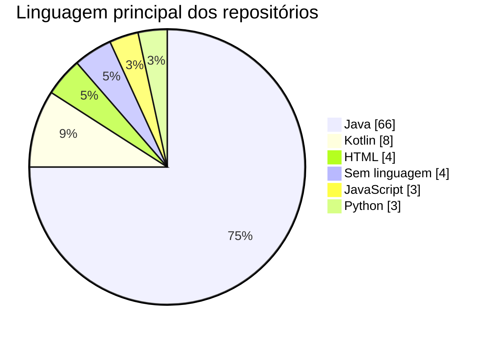

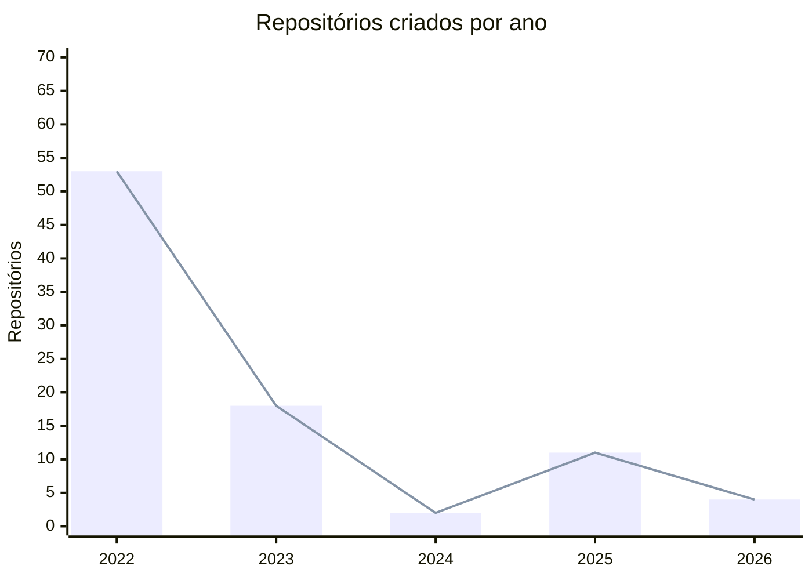

> 2022 foi o ano do volume (dezenas de exercícios do Catalisa). De 2025 em diante, a troca foi por **menos repositórios e projetos mais completos**, como o RKF Bank.

**🧊 Os mesmos números em 3D** (gire com o mouse, dê zoom com a roda). Da esquerda para a direita: 2022, 2023, 2024, 2025, 2026.

```stl
solid repositorios_por_ano
  facet normal 0.0000 0.0000 -1.0000
    outer loop
      vertex -4.000 -4.000 -1.000
      vertex -4.000 12.000 -1.000
      vertex 58.000 12.000 -1.000
    endloop
  endfacet
  facet normal 0.0000 0.0000 -1.0000
    outer loop
      vertex -4.000 -4.000 -1.000
      vertex 58.000 12.000 -1.000
      vertex 58.000 -4.000 -1.000
    endloop
  endfacet
  facet normal 0.0000 0.0000 1.0000
    outer loop
      vertex -4.000 -4.000 0.000
      vertex 58.000 -4.000 0.000
      vertex 58.000 12.000 0.000
    endloop
  endfacet
  facet normal 0.0000 0.0000 1.0000
    outer loop
      vertex -4.000 -4.000 0.000
      vertex 58.000 12.000 0.000
      vertex -4.000 12.000 0.000
    endloop
  endfacet
  facet normal 0.0000 -1.0000 0.0000
    outer loop
      vertex -4.000 -4.000 -1.000
      vertex 58.000 -4.000 -1.000
      vertex 58.000 -4.000 0.000
    endloop
  endfacet
  facet normal 0.0000 -1.0000 0.0000
    outer loop
      vertex -4.000 -4.000 -1.000
      vertex 58.000 -4.000 0.000
      vertex -4.000 -4.000 0.000
    endloop
  endfacet
  facet normal 0.0000 1.0000 0.0000
    outer loop
      vertex -4.000 12.000 -1.000
      vertex -4.000 12.000 0.000
      vertex 58.000 12.000 0.000
    endloop
  endfacet
  facet normal 0.0000 1.0000 0.0000
    outer loop
      vertex -4.000 12.000 -1.000
      vertex 58.000 12.000 0.000
      vertex 58.000 12.000 -1.000
    endloop
  endfacet
  facet normal -1.0000 0.0000 0.0000
    outer loop
      vertex -4.000 -4.000 -1.000
      vertex -4.000 -4.000 0.000
      vertex -4.000 12.000 0.000
    endloop
  endfacet
  facet normal -1.0000 0.0000 0.0000
    outer loop
      vertex -4.000 -4.000 -1.000
      vertex -4.000 12.000 0.000
      vertex -4.000 12.000 -1.000
    endloop
  endfacet
  facet normal 1.0000 0.0000 0.0000
    outer loop
      vertex 58.000 -4.000 -1.000
      vertex 58.000 12.000 -1.000
      vertex 58.000 12.000 0.000
    endloop
  endfacet
  facet normal 1.0000 0.0000 0.0000
    outer loop
      vertex 58.000 -4.000 -1.000
      vertex 58.000 12.000 0.000
      vertex 58.000 -4.000 0.000
    endloop
  endfacet
  facet normal 0.0000 0.0000 -1.0000
    outer loop
      vertex 0.000 0.000 0.000
      vertex 0.000 8.000 0.000
      vertex 8.000 8.000 0.000
    endloop
  endfacet
  facet normal 0.0000 0.0000 -1.0000
    outer loop
      vertex 0.000 0.000 0.000
      vertex 8.000 8.000 0.000
      vertex 8.000 0.000 0.000
    endloop
  endfacet
  facet normal 0.0000 0.0000 1.0000
    outer loop
      vertex 0.000 0.000 31.800
      vertex 8.000 0.000 31.800
      vertex 8.000 8.000 31.800
    endloop
  endfacet
  facet normal 0.0000 0.0000 1.0000
    outer loop
      vertex 0.000 0.000 31.800
      vertex 8.000 8.000 31.800
      vertex 0.000 8.000 31.800
    endloop
  endfacet
  facet normal 0.0000 -1.0000 0.0000
    outer loop
      vertex 0.000 0.000 0.000
      vertex 8.000 0.000 0.000
      vertex 8.000 0.000 31.800
    endloop
  endfacet
  facet normal 0.0000 -1.0000 0.0000
    outer loop
      vertex 0.000 0.000 0.000
      vertex 8.000 0.000 31.800
      vertex 0.000 0.000 31.800
    endloop
  endfacet
  facet normal 0.0000 1.0000 0.0000
    outer loop
      vertex 0.000 8.000 0.000
      vertex 0.000 8.000 31.800
      vertex 8.000 8.000 31.800
    endloop
  endfacet
  facet normal 0.0000 1.0000 0.0000
    outer loop
      vertex 0.000 8.000 0.000
      vertex 8.000 8.000 31.800
      vertex 8.000 8.000 0.000
    endloop
  endfacet
  facet normal -1.0000 0.0000 0.0000
    outer loop
      vertex 0.000 0.000 0.000
      vertex 0.000 0.000 31.800
      vertex 0.000 8.000 31.800
    endloop
  endfacet
  facet normal -1.0000 0.0000 0.0000
    outer loop
      vertex 0.000 0.000 0.000
      vertex 0.000 8.000 31.800
      vertex 0.000 8.000 0.000
    endloop
  endfacet
  facet normal 1.0000 0.0000 0.0000
    outer loop
      vertex 8.000 0.000 0.000
      vertex 8.000 8.000 0.000
      vertex 8.000 8.000 31.800
    endloop
  endfacet
  facet normal 1.0000 0.0000 0.0000
    outer loop
      vertex 8.000 0.000 0.000
      vertex 8.000 8.000 31.800
      vertex 8.000 0.000 31.800
    endloop
  endfacet
  facet normal 0.0000 0.0000 -1.0000
    outer loop
      vertex 12.000 0.000 0.000
      vertex 12.000 8.000 0.000
      vertex 20.000 8.000 0.000
    endloop
  endfacet
  facet normal 0.0000 0.0000 -1.0000
    outer loop
      vertex 12.000 0.000 0.000
      vertex 20.000 8.000 0.000
      vertex 20.000 0.000 0.000
    endloop
  endfacet
  facet normal 0.0000 0.0000 1.0000
    outer loop
      vertex 12.000 0.000 10.800
      vertex 20.000 0.000 10.800
      vertex 20.000 8.000 10.800
    endloop
  endfacet
  facet normal 0.0000 0.0000 1.0000
    outer loop
      vertex 12.000 0.000 10.800
      vertex 20.000 8.000 10.800
      vertex 12.000 8.000 10.800
    endloop
  endfacet
  facet normal 0.0000 -1.0000 0.0000
    outer loop
      vertex 12.000 0.000 0.000
      vertex 20.000 0.000 0.000
      vertex 20.000 0.000 10.800
    endloop
  endfacet
  facet normal 0.0000 -1.0000 0.0000
    outer loop
      vertex 12.000 0.000 0.000
      vertex 20.000 0.000 10.800
      vertex 12.000 0.000 10.800
    endloop
  endfacet
  facet normal 0.0000 1.0000 0.0000
    outer loop
      vertex 12.000 8.000 0.000
      vertex 12.000 8.000 10.800
      vertex 20.000 8.000 10.800
    endloop
  endfacet
  facet normal 0.0000 1.0000 0.0000
    outer loop
      vertex 12.000 8.000 0.000
      vertex 20.000 8.000 10.800
      vertex 20.000 8.000 0.000
    endloop
  endfacet
  facet normal -1.0000 0.0000 0.0000
    outer loop
      vertex 12.000 0.000 0.000
      vertex 12.000 0.000 10.800
      vertex 12.000 8.000 10.800
    endloop
  endfacet
  facet normal -1.0000 0.0000 0.0000
    outer loop
      vertex 12.000 0.000 0.000
      vertex 12.000 8.000 10.800
      vertex 12.000 8.000 0.000
    endloop
  endfacet
  facet normal 1.0000 0.0000 0.0000
    outer loop
      vertex 20.000 0.000 0.000
      vertex 20.000 8.000 0.000
      vertex 20.000 8.000 10.800
    endloop
  endfacet
  facet normal 1.0000 0.0000 0.0000
    outer loop
      vertex 20.000 0.000 0.000
      vertex 20.000 8.000 10.800
      vertex 20.000 0.000 10.800
    endloop
  endfacet
  facet normal 0.0000 0.0000 -1.0000
    outer loop
      vertex 24.000 0.000 0.000
      vertex 24.000 8.000 0.000
      vertex 32.000 8.000 0.000
    endloop
  endfacet
  facet normal 0.0000 0.0000 -1.0000
    outer loop
      vertex 24.000 0.000 0.000
      vertex 32.000 8.000 0.000
      vertex 32.000 0.000 0.000
    endloop
  endfacet
  facet normal 0.0000 0.0000 1.0000
    outer loop
      vertex 24.000 0.000 1.200
      vertex 32.000 0.000 1.200
      vertex 32.000 8.000 1.200
    endloop
  endfacet
  facet normal 0.0000 0.0000 1.0000
    outer loop
      vertex 24.000 0.000 1.200
      vertex 32.000 8.000 1.200
      vertex 24.000 8.000 1.200
    endloop
  endfacet
  facet normal 0.0000 -1.0000 0.0000
    outer loop
      vertex 24.000 0.000 0.000
      vertex 32.000 0.000 0.000
      vertex 32.000 0.000 1.200
    endloop
  endfacet
  facet normal 0.0000 -1.0000 0.0000
    outer loop
      vertex 24.000 0.000 0.000
      vertex 32.000 0.000 1.200
      vertex 24.000 0.000 1.200
    endloop
  endfacet
  facet normal 0.0000 1.0000 0.0000
    outer loop
      vertex 24.000 8.000 0.000
      vertex 24.000 8.000 1.200
      vertex 32.000 8.000 1.200
    endloop
  endfacet
  facet normal 0.0000 1.0000 0.0000
    outer loop
      vertex 24.000 8.000 0.000
      vertex 32.000 8.000 1.200
      vertex 32.000 8.000 0.000
    endloop
  endfacet
  facet normal -1.0000 0.0000 0.0000
    outer loop
      vertex 24.000 0.000 0.000
      vertex 24.000 0.000 1.200
      vertex 24.000 8.000 1.200
    endloop
  endfacet
  facet normal -1.0000 0.0000 0.0000
    outer loop
      vertex 24.000 0.000 0.000
      vertex 24.000 8.000 1.200
      vertex 24.000 8.000 0.000
    endloop
  endfacet
  facet normal 1.0000 0.0000 0.0000
    outer loop
      vertex 32.000 0.000 0.000
      vertex 32.000 8.000 0.000
      vertex 32.000 8.000 1.200
    endloop
  endfacet
  facet normal 1.0000 0.0000 0.0000
    outer loop
      vertex 32.000 0.000 0.000
      vertex 32.000 8.000 1.200
      vertex 32.000 0.000 1.200
    endloop
  endfacet
  facet normal 0.0000 0.0000 -1.0000
    outer loop
      vertex 36.000 0.000 0.000
      vertex 36.000 8.000 0.000
      vertex 44.000 8.000 0.000
    endloop
  endfacet
  facet normal 0.0000 0.0000 -1.0000
    outer loop
      vertex 36.000 0.000 0.000
      vertex 44.000 8.000 0.000
      vertex 44.000 0.000 0.000
    endloop
  endfacet
  facet normal 0.0000 0.0000 1.0000
    outer loop
      vertex 36.000 0.000 6.600
      vertex 44.000 0.000 6.600
      vertex 44.000 8.000 6.600
    endloop
  endfacet
  facet normal 0.0000 0.0000 1.0000
    outer loop
      vertex 36.000 0.000 6.600
      vertex 44.000 8.000 6.600
      vertex 36.000 8.000 6.600
    endloop
  endfacet
  facet normal 0.0000 -1.0000 0.0000
    outer loop
      vertex 36.000 0.000 0.000
      vertex 44.000 0.000 0.000
      vertex 44.000 0.000 6.600
    endloop
  endfacet
  facet normal 0.0000 -1.0000 0.0000
    outer loop
      vertex 36.000 0.000 0.000
      vertex 44.000 0.000 6.600
      vertex 36.000 0.000 6.600
    endloop
  endfacet
  facet normal 0.0000 1.0000 0.0000
    outer loop
      vertex 36.000 8.000 0.000
      vertex 36.000 8.000 6.600
      vertex 44.000 8.000 6.600
    endloop
  endfacet
  facet normal 0.0000 1.0000 0.0000
    outer loop
      vertex 36.000 8.000 0.000
      vertex 44.000 8.000 6.600
      vertex 44.000 8.000 0.000
    endloop
  endfacet
  facet normal -1.0000 0.0000 0.0000
    outer loop
      vertex 36.000 0.000 0.000
      vertex 36.000 0.000 6.600
      vertex 36.000 8.000 6.600
    endloop
  endfacet
  facet normal -1.0000 0.0000 0.0000
    outer loop
      vertex 36.000 0.000 0.000
      vertex 36.000 8.000 6.600
      vertex 36.000 8.000 0.000
    endloop
  endfacet
  facet normal 1.0000 0.0000 0.0000
    outer loop
      vertex 44.000 0.000 0.000
      vertex 44.000 8.000 0.000
      vertex 44.000 8.000 6.600
    endloop
  endfacet
  facet normal 1.0000 0.0000 0.0000
    outer loop
      vertex 44.000 0.000 0.000
      vertex 44.000 8.000 6.600
      vertex 44.000 0.000 6.600
    endloop
  endfacet
  facet normal 0.0000 0.0000 -1.0000
    outer loop
      vertex 48.000 0.000 0.000
      vertex 48.000 8.000 0.000
      vertex 56.000 8.000 0.000
    endloop
  endfacet
  facet normal 0.0000 0.0000 -1.0000
    outer loop
      vertex 48.000 0.000 0.000
      vertex 56.000 8.000 0.000
      vertex 56.000 0.000 0.000
    endloop
  endfacet
  facet normal 0.0000 0.0000 1.0000
    outer loop
      vertex 48.000 0.000 2.400
      vertex 56.000 0.000 2.400
      vertex 56.000 8.000 2.400
    endloop
  endfacet
  facet normal 0.0000 0.0000 1.0000
    outer loop
      vertex 48.000 0.000 2.400
      vertex 56.000 8.000 2.400
      vertex 48.000 8.000 2.400
    endloop
  endfacet
  facet normal 0.0000 -1.0000 0.0000
    outer loop
      vertex 48.000 0.000 0.000
      vertex 56.000 0.000 0.000
      vertex 56.000 0.000 2.400
    endloop
  endfacet
  facet normal 0.0000 -1.0000 0.0000
    outer loop
      vertex 48.000 0.000 0.000
      vertex 56.000 0.000 2.400
      vertex 48.000 0.000 2.400
    endloop
  endfacet
  facet normal 0.0000 1.0000 0.0000
    outer loop
      vertex 48.000 8.000 0.000
      vertex 48.000 8.000 2.400
      vertex 56.000 8.000 2.400
    endloop
  endfacet
  facet normal 0.0000 1.0000 0.0000
    outer loop
      vertex 48.000 8.000 0.000
      vertex 56.000 8.000 2.400
      vertex 56.000 8.000 0.000
    endloop
  endfacet
  facet normal -1.0000 0.0000 0.0000
    outer loop
      vertex 48.000 0.000 0.000
      vertex 48.000 0.000 2.400
      vertex 48.000 8.000 2.400
    endloop
  endfacet
  facet normal -1.0000 0.0000 0.0000
    outer loop
      vertex 48.000 0.000 0.000
      vertex 48.000 8.000 2.400
      vertex 48.000 8.000 0.000
    endloop
  endfacet
  facet normal 1.0000 0.0000 0.0000
    outer loop
      vertex 56.000 0.000 0.000
      vertex 56.000 8.000 0.000
      vertex 56.000 8.000 2.400
    endloop
  endfacet
  facet normal 1.0000 0.0000 0.0000
    outer loop
      vertex 56.000 0.000 0.000
      vertex 56.000 8.000 2.400
      vertex 56.000 0.000 2.400
    endloop
  endfacet
endsolid repositorios_por_ano
```

</details>
<!-- AUTO:repos:END -->

<details>
<summary><b>🌐 Workshop Spring Boot 4 + JPA — API REST de e-commerce</b></summary>
<br/>

<p>
  
  
  
  
  
</p>

| Funcionalidade | Detalhe |
|---|---|
| CRUD completo | usuários com todos os verbos HTTP |
| Relacionamentos JPA | `OneToMany`, `ManyToOne`, `ManyToMany`, `OneToOne` |
| Chave composta | `@EmbeddedId` em `OrderItem` |
| Enum persistido | conversão inteiro ↔ enum via getter/setter |
| Exceções globais | `@ControllerAdvice` + `ResourceNotFoundException` |
| Perfis de ambiente | `test` (H2) e `dev` (PostgreSQL) |

🔗 **[workshop-springboot4-jpa](https://github.com/k3vinrich4rd/workshop-springboot4-jpa)**

</details>

<details>
<summary><b>🍃 Workshop Spring Boot 4 + MongoDB — API REST NoSQL</b></summary>
<br/>

<p>
  
  
  
</p>

| Funcionalidade | Detalhe |
|---|---|
| CRUD de usuários | listagem, busca por id, inserção, atualização e remoção |
| DTOs | `UserDto`, `AuthorDto` e `CommentDto` para entrada e saída de dados |
| Posts | posts com autor resumido e comentários embutidos |
| Consultas MongoDB | busca por título e busca completa com texto + intervalo de datas |
| Relacionamentos | `DBRef` para os posts do usuário e documentos embutidos para comentários |
| Seed automático | dados recriados no startup via `CommandLineRunner` |

🔗 **[workshop-springboot4-mongodb](https://github.com/k3vinrich4rd/workshop-springboot4-mongodb)**

</details>

<details>
<summary><b>🛒 DSCommerce — modelo de domínio e ORM (Spring Professional)</b></summary>
<br/>

| Conceito | Onde aparece |
|---|---|
| Modelo de domínio | `User`, `Order`, `Product`, `Category`, `Payment` |
| Chave composta | `OrdemItemPK` no item do pedido |
| Camadas | controller → service → repository com `ProductDto` |
| Erros padronizados | `CustomError`, `ValidationError` e `FieldMessage` |
| Exceções de serviço | `ResourceNotFoundException` e `DatabaseException` (integridade referencial) |
| Seed | `import.sql` com perfil `test` em H2 |

🔗 **[JAVA-SPRING-PROFESSIONAL-MODELO-DE-DOMINIO-ORM](https://github.com/k3vinrich4rd/JAVA-SPRING-PROFESSIONAL-MODELO-DE-DOMINIO-ORM)**

</details>

<details>
<summary><b>👥 Desafio DevSuperior — CRUD de Clientes (10/10)</b></summary>
<br/>

- API REST com as 5 operações do CRUD e **busca paginada** (`?page=0&size=6&sort=name`).
- `404` para id inexistente e `422` com mensagem customizada por campo (`@PastOrPresent`, `@NotBlank`).
- Seed com 10 clientes no H2 para testar na hora.
- **Checklist de correção: 10 de 10 itens aprovados.**

🔗 **[desafio-devsuperior-crud-clientes](https://github.com/k3vinrich4rd/desafio-devsuperior-crud-clientes)**

</details>

<details>
<summary><b>📚 BookMarket — API em Kotlin com Spring Security</b></summary>
<br/>

- API REST de livraria com clientes, livros e compras, escrita em **Kotlin**.
- **Spring Security** com filtro de autenticação próprio e login.
- **Eventos de domínio**: uma compra dispara listeners que geram a NF-e e marcam os livros como vendidos.
- Validador customizado (`@EmailAvailable`), `ControllerAdvice` com erros padronizados e documentação com **Swagger**.

🔗 **[BookMarket](https://github.com/k3vinrich4rd/BookMarket)**

</details>

<details>
<summary><b>📦 Outros repositórios que contam a minha evolução</b></summary>
<br/>

| Tema | Repositórios |
|---|---|
| Fundamentos de Java e POO | [Curso Java COMPLETO](https://github.com/k3vinrich4rd/Curso-Java-COMPLETO-Programa-o-Orientada-a-Objetos-Projetos) · [Estudos_JAVA](https://github.com/k3vinrich4rd/Estudos_JAVA) · [LkBank](https://github.com/k3vinrich4rd/lk-bank) (em dupla) |
| SOLID e Design Patterns | [SOLID OCP/SRP](https://github.com/k3vinrich4rd/Lista-L6A-L6B-Refatoracao) · [Factory Method](https://github.com/k3vinrich4rd/RefazandoTrabalho_DesingPatternFactory) · [State](https://github.com/k3vinrich4rd/TrabalhandoComState) |
| Testes | [Mockito](https://github.com/k3vinrich4rd/TrabalhandoComMockito) · [MockMvc](https://github.com/k3vinrich4rd/TrabalhandoComMockMvc) · [TDD com @MockBean](https://github.com/k3vinrich4rd/TesteTDDComMockBean) · [Conhecendo Mockito](https://github.com/k3vinrich4rd/Conhecendo-Mockito) |
| Segurança | [Spring Security com usuários](https://github.com/k3vinrich4rd/UsuariosSecurity) · [criptografia de senhas](https://github.com/k3vinrich4rd/ProdutosSeguranca) |
| Spring Boot | [Intensivão Java Spring](https://github.com/k3vinrich4rd/intensivao-java-spring) · [Injeção de dependência](https://github.com/k3vinrich4rd/desafio-devsuperior-componentes-injecao-dependencia) · [Spring Boot Essentials](https://github.com/k3vinrich4rd/SpringBoot-Essentials) · [Spring Boot 3](https://github.com/k3vinrich4rd/ConhecendoSpringBoot3) · [Agenda Telefônica (Catalisa)](https://github.com/k3vinrich4rd/AgendaTelefonicaCatalisa) |

</details>


## 📈 Junior → Pleno — onde estou

> O que separa um Junior de um Pleno não é só saber mais tecnologia: é **entregar com autonomia, qualidade e visão do todo**. Esta é a minha régua, com evidências.

<div align="center">
  
</div>

<details>
<summary><b>🗺️ Mapa de habilidades (diagrama interativo)</b></summary>
<br/>

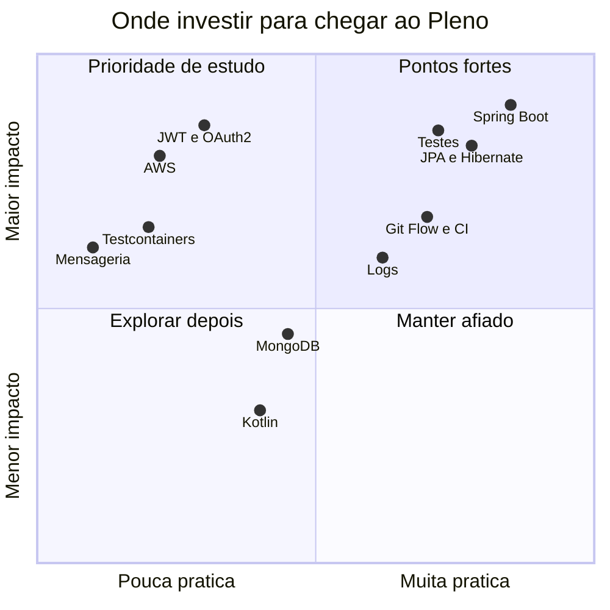

</details>

<details open>
<summary><b>✅ Competências e evidências</b></summary>
<br/>

<!-- AUTO:regua:START -->
| Competência de Pleno | Status | Evidência |
|---|:-:|---|
| API REST em camadas com DTOs e erros padronizados | ✅ | RKF Bank, DSCommerce, Workshop JPA |
| Modelagem JPA: relacionamentos, chave composta, cascata | ✅ | Workshop JPA, DSCommerce, RKF Bank |
| Testes unitários, web e de repositório | ✅ | RKF Bank |
| Transações e concorrência | ✅ | RKF Bank |
| Integração com API externa e falhas | ✅ | RKF Bank (ViaCEP) |
| Logs e rastreabilidade | ✅ | RKF Bank |
| CI/CD, segurança e dependências | ✅ | RKF Bank |
| Git Flow, PRs e commits semânticos | ✅ | RKF Bank |
| Banco NoSQL | ✅ | Workshop MongoDB |
| Migrações versionadas | 🔄 | ⏫ próximo da fila |
| Autenticação e autorização | 🔄 | em andamento |
| Testes de integração com banco real | 🔄 | em andamento |
| Deploy em nuvem | 🔄 | em andamento |
| Inglês técnico | 🔄 | em andamento |
| Mensageria e microsserviços | ⏳ | próximo ciclo |

<sub>✅ praticado em projeto · 🔄 em andamento · ⏳ planejado · gerado do meu Obsidian em 2026-10-15</sub>
<!-- AUTO:regua:END -->

</details>

<details>
<summary><b>📚 Mapa vivo dos meus estudos (sincronizado com o Obsidian)</b></summary>
<br/>

<!-- AUTO:estudos:START -->
**19** assuntos praticados em projeto · **6** em andamento · **1** planejados

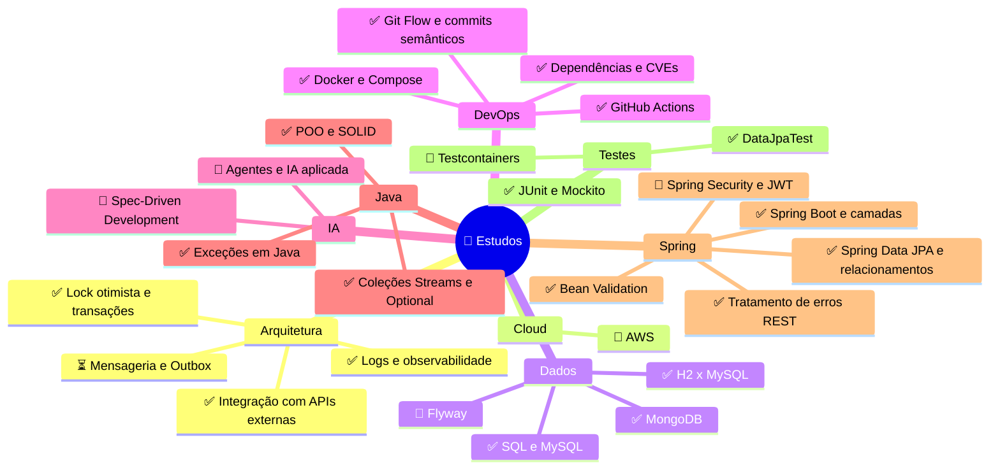

| Estudando agora | Área | Próximos passos |
|---|---|---|
| 🔄 AWS | Cloud | `░░░░░░░░░░` 0/10 |
| 🔄 Flyway | Dados | `░░░░░░░░░░` 0/5 |
| 🔄 Agentes e IA aplicada | IA | `░░░░░░░░░░` 0/2 |
| 🔄 Spec-Driven Development | IA | `░░░░░░░░░░` 0/1 |
| 🔄 Spring Security e JWT | Spring | `░░░░░░░░░░` 0/8 |
| 🔄 Testcontainers | Testes | `░░░░░░░░░░` 0/7 |
| ⏳ Mensageria e Outbox | Arquitetura | `░░░░░░░░░░` 0/6 |

<sub>🤖 Lido das notas de estudo do meu Obsidian em 2026-10-15.</sub>
<!-- AUTO:estudos:END -->

</details>


## 📊 GitHub Stats

<div align="center">


</div>

<!-- Gerado pelo workflow .github/workflows/snake.yml (branch "output"). -->
<picture>
  <source media="(prefers-color-scheme: dark)" srcset="https://raw.githubusercontent.com/k3vinrich4rd/k3vinrich4rd/output/profile-night-rainbow.svg" />
  <source media="(prefers-color-scheme: light)" srcset="https://raw.githubusercontent.com/k3vinrich4rd/k3vinrich4rd/output/profile-season-animate.svg" />
  
</picture>


## 🎯 PDI — Roadmap 2026

> *Objetivo:* consolidar a transição de **Junior para Pleno** com base técnica sólida.

<div align="center">

| Pilar | Status | Foco |
|---|---|---|
| ☕ Java + Spring |  | Spring Boot, JPA, MongoDB, testes |
| ☁️ AWS |  | EC2, S3, Lambda, IAM, Cloud Practitioner |
| 🤖 Agent IA |  | LLMs, agentes, integração Java + IA |
| 🧠 Spec-Driven Dev |  | API First, OpenAPI, contratos |
| 📈 Skill em IA |  | Copilot, produtividade técnica com IA |

</div>

<details open>
<summary><b>📅 Cronograma: do MVP do RKF Bank ao Pleno</b></summary>
<br/>

<!-- AUTO:gantt:START -->
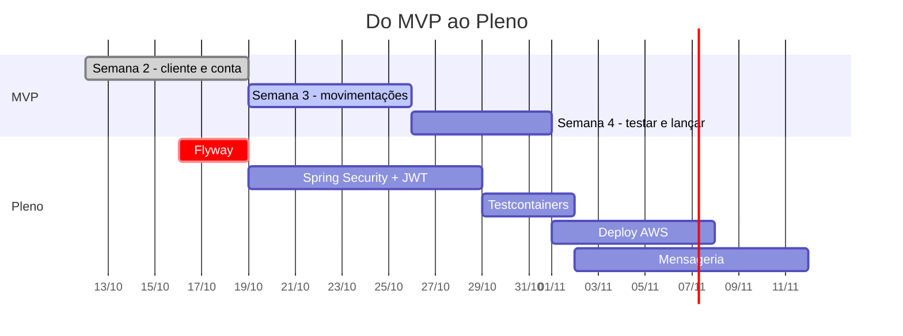
<!-- AUTO:gantt:END -->

</details>

<details>
<summary><b>✅ Checklist público do que falta (sincronizado com o meu Obsidian)</b></summary>
<br/>

<!-- AUTO:checklist:START -->
**✔️ Concluído recentemente**
- ✅ Documentação dos testes de repositório — 2026-10-15
- ✅ CVEs do Tomcat (3 críticas) e do Jackson (5 altas, 2 moderadas) corrigidas — 2026-10-15
- ✅ H2 fixado em 2.3.232 (bug do `CHECK ... IN` no 2.4.240) — 2026-10-15
- ✅ Testes da camada repositories (34 testes, `@DataJpaTest`) — 2026-10-15

**🚀 MVP do RKF Bank (31/10/2026)** `░░░░░░░░░░░░` 0%

<b>Backend</b> <sub>0/3</sub>

- [ ] `GET /contas/{contaId}` (saldo)
- [ ] `GET /clientes/{clienteId}/contas`
- [ ] Decidir como o usuário acessa a conta sem login (ver Decisões RKF Bank)

<b>Frontend (Renan)</b> <sub>0/4</sub>

- [ ] Abrir conta depois do cadastro
- [ ] Tela da conta (saldo)
- [ ] Telas de depósito, saque e transferência
- [ ] Tela de extrato

<b>Lançamento</b> <sub>0/5</sub>

- [ ] Decidir onde publicar (ver Decisões RKF Bank)
- [ ] Fellipe (PO & QA) testa tudo pelo roteiro E2E
- [ ] Corrigir os bugs encontrados
- [ ] Colocar no ar
- [ ] Atualizar o README com link e prints

**📏 Rumo ao Pleno** `░░░░░░░░░░░░` 0/26 passos

- [ ] **Flyway** ⏫ **próximo** `░░░░░░░░` 0/6
- [ ] **Spring Security + JWT** `░░░░░░░░` 0/6
- [ ] **Testcontainers** `░░░░░░░░` 0/4
- [ ] **Deploy AWS** 🔮 `░░░░░░░░` 0/5
- [ ] **Mensageria** 🔮 `░░░░░░░░` 0/3
- [ ] **Inglês** `░░░░░░░░` 0/2

**🧹 Débitos técnicos:** 0/18 resolvidos

<sub>🤖 Sincronizado com o checklist do meu Obsidian em 2026-10-15.</sub>
<!-- AUTO:checklist:END -->

</details>

<details>
<summary><b>☕ Próximo foco em Spring Professional</b></summary>
<br/>

- [x] camadas, DTOs, CRUD e validações;
- [x] exceções customizadas e padrão REST;
- [x] testes de repositório e lock otimista (RKF Bank);
- [ ] JPA avançado: consultas, N+1 e performance;
- [ ] autenticação e autorização com JWT / OAuth2;
- [ ] migrações com Flyway e testes de integração com Testcontainers;
- [ ] deploy, perfis e CI/CD até a nuvem.

</details>

<details>
<summary><b>☁️ AWS — ver detalhes</b></summary>
<br/>

<p>
  
  
  
  
  
</p>

- Infraestrutura como código e provisionamento.
- Deploy de aplicações Spring Boot na AWS.
- Arquitetura serverless com Lambda.
- Preparação para a Cloud Practitioner.

</details>

<details>
<summary><b>🤖 Agent IA — ver detalhes</b></summary>
<br/>

<p>
  
  
</p>

- Estudo a aplicação prática de **LLMs, agentes e assistentes de IA** no desenvolvimento de software.
- Foco em conectar IA com backend Java: automação de tarefas, revisão de código e produtividade técnica.
- Também aprofundo **agentes autônomos**: contexto, restrições, tomada de decisão e uso responsável da IA no dia a dia.

</details>

<details>
<summary><b>🧠 Spec-Driven Dev — ver detalhes</b></summary>
<br/>

<p>
  
  
  
</p>

- **Spec-Driven Development (SDD)** é uma abordagem em que especificações estruturadas viram a principal fonte da verdade para orientar agentes e assistentes de IA na geração de código.
- O código deixa de ser o artefato central e passa a ser consequência de especificações bem escritas, com contexto, regras e limites claros.
- Isso reduz o **"vibe coding"**: menos soluções improvisadas a partir de prompts vagos, mais guardrails de arquitetura, negócio e dependências.
- A documentação fica viva: arquivos Markdown como `specs`, `design` e `constitution` são lidos por pessoas e por máquinas.
- **Vantagens:** mais assertividade, menos desvio de padrão e o dev evoluindo para arquiteto de especificações e revisor crítico.
- Referências: [SoftDesign](https://www.softdesign.com.br/blog/spec-driven-development/), [Hack the Task](https://hackthetask.com.br/2026/03/20/spec-driven-development-com-claude-code/), [DS Academy](https://blog.dsacademy.com.br/spec-driven-development-a-nova-arquitetura-de-engenharia-de-software-na-era-dos-agentes-de-ia-parte-1/), [DIO](https://www.dio.me/articles/spec-driven-domain-sdd-estruturando-o-desenvolvimento-de-software-na-era-da-ia-generativa-c605bd734d9e), [YouTube 1](https://www.youtube.com/watch?v=8azw00qmfVE&t=122), [YouTube 2](https://www.youtube.com/shorts/ab4UDMayVlo), [YouTube 3](https://www.youtube.com/shorts/_jVLZQUO6lY).

</details>

<details>
<summary><b>📈 Skill em IA — ver detalhes</b></summary>
<br/>

<p>
  
  
</p>

- Meu objetivo é transformar IA em **alavanca real de produtividade**, não só em geração de código.
- Isso inclui o uso estratégico de assistentes e agentes em arquitetura, documentação, code review, estudos e refinamento técnico.
- Faz parte dessa trilha desenvolver comunicação técnica, visão sistêmica e capacidade de revisar criticamente o que a IA produz.

</details>


## 🛠️ Tecnologias

<div align="center">


</div>

<details>
<summary><b>🧠 Mapa mental da stack</b></summary>
<br/>

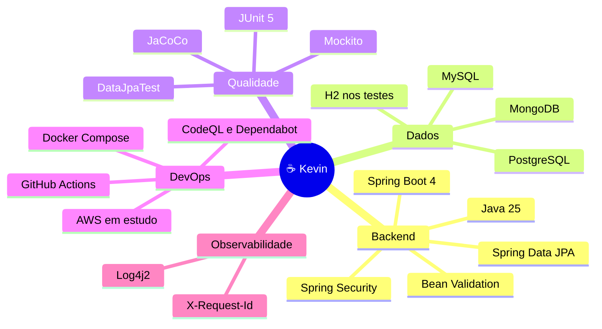

</details>

<details>
<summary><b>Ver a stack por categoria</b></summary>
<br/>

| Categoria | Tecnologias |
|---|---|
| Linguagens |   |
| Frameworks |     |
| Bancos |     |
| Testes |     |
| DevOps |     |
| Observabilidade |  |
| Ferramentas |     |

</details>


## 💼 Atuação profissional

<div align="center">


</div>

<br/>

Atuo como **Desenvolvedor de Software Junior** contratado pela **[Zup Innovation](https://www.linkedin.com/company/zupinnovation/posts/?feedView=all)**, empresa do grupo **Itaú**, prestando serviço diretamente para o maior banco privado do Brasil.

<div align="center">

| Área | Competência |
|---|---|
| Técnico | Java, Spring Boot, APIs REST, JPA/Hibernate, MongoDB, testes |
| Colaboração | trabalho em equipe, comunicação técnica, code review |
| Entregas | responsabilidade, proatividade, foco em qualidade |
| Evolução | aprendizado contínuo, mentoria, adaptação a desafios |
| Inglês | básico — em desenvolvimento ativo |

</div>


## 💬 Pergunte ao Kevin

> Perguntas que costumam aparecer em entrevista, respondidas com o que eu fiz de verdade. Clique para abrir.

<details>
<summary><b>Como você garante que uma transferência não deixa o saldo errado?</b></summary>
<br/>

Duas camadas de proteção no RKF Bank:
1. **Transação** (`@Transactional`): débito, crédito e lançamento do extrato são confirmados juntos, ou nada é salvo.
2. **Lock otimista** (`@Version` na `Conta`): se duas operações leem a mesma conta ao mesmo tempo, a segunda a gravar recebe um conflito e a API responde `409`, em vez de sobrescrever o saldo.

Os dois comportamentos são cobertos por testes (`ContaRepositoryTest` e `ControllerExceptionHandlerTest`).

</details>

<details>
<summary><b>Por que testar repositório, se o Spring Data já gera as consultas?</b></summary>
<br/>

Porque o que quebra não é o Spring, é o **meu mapeamento**: nome de método derivado errado, cascata que não apaga o filho, constraint que não existe. Com `@DataJpaTest` eu testo o extrato (origem **ou** destino, do mais novo ao mais antigo), CPF duplicado, `orphanRemoval` e o `@Version`.

E um bug real apareceu assim: o **H2 2.4.240** quebrava os inserts nas tabelas com enum. Fixei a versão e documentei. É também por isso que o próximo passo é testar com MySQL real (Testcontainers).

</details>

<details>
<summary><b>O que acontece se o ViaCEP cair?</b></summary>
<br/>

A chamada tem **timeout de 3 s**. Se o ViaCEP não responder, a API devolve `503` com uma mensagem clara, em vez de travar. CEP inexistente vira `422`. São 6 testes cobrindo sucesso, CEP inexistente e falha. Próximo nível que estou estudando: retry e circuit breaker com Resilience4j.

</details>

<details>
<summary><b>Como você rastreia um erro em produção?</b></summary>
<br/>

Cada requisição recebe um `X-Request-Id` (ou reaproveita o que o frontend mandou). Ele aparece em **toda linha de log**, de todas as camadas, inclusive no SQL do Hibernate. Com o id do erro, eu filtro o caminho inteiro da requisição. O filtro também rejeita ids com quebra de linha, para ninguém forjar linhas de log.

</details>

<details>
<summary><b>Como você lida com vulnerabilidades em dependências?</b></summary>
<br/>

O CI tem **CodeQL**, **Dependency Review** e **Dependabot**. Quando o Spring Boot mais recente ainda trazia um Tomcat com 3 CVEs críticas e um Jackson com 7 CVEs, eu sobrescrevi só essas duas versões no `pom.xml`, validei com a suíte completa e com a aplicação rodando contra o MySQL, e deixei um comentário para remover a sobrescrita quando o Spring Boot alcançar.

</details>

### 🎯 Desafio relâmpago: quanto você sabe de backend?

> Três perguntas tiradas dos meus projetos. Escolha uma resposta e clique para ver se acertou.

**1. Duas transferências tentam debitar a mesma conta ao mesmo tempo. Com `@Version` na entidade, o que acontece com a segunda?**

<details><summary>A) Sobrescreve o saldo da primeira</summary>

❌ **Ainda não.** Isso é o que o lock otimista evita: sem ele, uma escrita apagaria a outra.

</details>
<details><summary>B) Recebe um conflito e a API devolve 409</summary>

✅ **Isso!** A versão lida já não é a atual, o Hibernate lança <code>OptimisticLockException</code> e o RKF Bank responde <code>409</code>.

</details>
<details><summary>C) Fica esperando a primeira terminar</summary>

❌ **Ainda não.** Esse é o lock <b>pessimista</b> (<code>SELECT ... FOR UPDATE</code>). O otimista não bloqueia, ele detecta o conflito.

</details>

**2. Um pedido tem vários produtos e cada item guarda quantidade e preço. Como mapear?**

<details><summary>A) @ManyToMany direto entre Order e Product</summary>

❌ **Ainda não.** O <code>@ManyToMany</code> puro não tem onde guardar quantidade e preço.

</details>
<details><summary>B) Entidade OrderItem com chave composta (@EmbeddedId)</summary>

✅ **Isso!** Exatamente o que eu fiz no DSCommerce com <code>OrdemItemPK</code>: a associação vira entidade e ganha dados próprios.

</details>
<details><summary>C) Uma lista de ids de produto dentro do pedido</summary>

❌ **Ainda não.** Perde a integridade referencial e não guarda o preço da compra.

</details>

**3. O ViaCEP não responde. Qual a melhor resposta da API de cadastro?**

<details><summary>A) Ficar esperando até o ViaCEP voltar</summary>

❌ **Ainda não.** Uma dependência lenta não pode travar a sua API inteira.

</details>
<details><summary>B) 500 Internal Server Error</summary>

❌ **Ainda não.** O erro não é seu, é de um serviço externo. 500 esconde a causa.

</details>
<details><summary>C) Timeout curto e 503 Service Unavailable</summary>

✅ **Isso!** É o que o RKF Bank faz: timeout de 3 s e <code>503</code> com mensagem clara. CEP inexistente vira <code>422</code>.

</details>


## 🎓 Formação e certificações

<details>
<summary><b>☕ Java e desenvolvimento backend</b></summary>
<br/>

| Certificação | Instituição |
|---|---|
| Formação Java com Orientação a Objetos | Alura |
| Java: consumindo API, gravando arquivos e lidando com erros | Alura |
| Java: aplicando a Orientação a Objetos | Alura |
| Java: trabalhando com listas e coleções de dados | Alura |
| Java: criando a sua primeira aplicação | Alura |
| Spring Boot 3: desenvolva uma API Rest em Java | Alura |
| TDD e Java: testes automatizados com JUnit | Alura |
| Mocks em Java: conhecendo o Mockito | Alura |
| Java COMPLETO Programação Orientada a Objetos + Projetos | Udemy |

</details>

<details>
<summary><b>🗄️ Banco de dados</b></summary>
<br/>

| Certificação | Instituição |
|---|---|
| SQL com MySQL: manipule e consulte dados | Alura |
| Comandos DML: manipulação de dados com MySQL | Alura |
| Consultas SQL: avançando no SQL com MySQL | Alura |

</details>

<details>
<summary><b>☁️ Cloud e infraestrutura</b></summary>
<br/>

| Certificação | Instituição |
|---|---|
| Formação Começando em Cloud Computing | Alura |
| Amazon EC2: alta disponibilidade e escalabilidade | Alura |
| Exam Readiness: AWS Certified Cloud Practitioner | AWS |
| Linux Onboarding: usando a CLI de forma prática | Alura |

</details>

<details>
<summary><b>➕ Complementares</b></summary>
<br/>

| Certificação | Instituição |
|---|---|
| Formação Linguagem Kotlin | Alura |
| Curso Git e GitHub | Workover |

</details>

---

<div align="center">

<a href="https://www.linkedin.com/in/kevin-richard-b68a54203/" target="_blank"></a>


<a href="https://www.linkedin.com/in/kevin-richard-b68a54203/" target="_blank"></a>

[](https://git.io/typing-svg)

</div>
